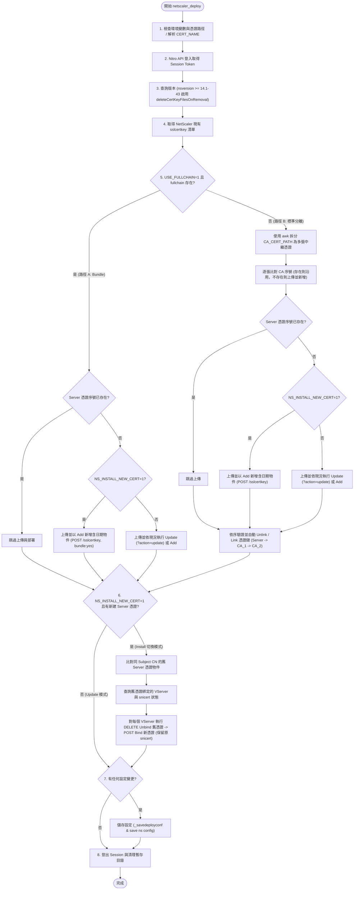

# NetScaler Nitro API Deploy Hook

這是一個用於 `acme.sh` 的部署腳本，專門設計用來自動將 SSL 憑證部署到 Citrix NetScaler ADC (透過 Nitro API)。

## 功能特點

- 自動上傳憑證 (.cer) 與私鑰 (.key) 到 NetScaler。
- 支援標準憑證部署 (Server Cert + CA Cert) 與 Fullchain Bundle 部署。
- 自動偵測 NetScaler 版本，並針對支援的版本開啟 `deleteCertKeyFilesOnRemoval` 選項。
- 支援將 CA 憑證連結 (Link) 到 Server 憑證。
- 支援加密的私鑰 (需提供密碼)。
- 可選：自動刪除舊的憑證檔案以節省空間。
- 詳細的 API 請求日誌紀錄功能 (Debug 用)。

## 前置需求

- **acme.sh**: 必須已安裝並能成功簽發憑證。
- **NetScaler 帳號權限**: 需有足夠權限執行 `add ssl certKey`, `link ssl certKey`, `save ns config` 等操作。
- **工具**: 執行環境需有 `curl`, `openssl`, `awk`, `grep`, `sed`。

## 安裝與設定

將 `netscaler.sh` 放置於 `acme.sh` 的 `deploy` 目錄下 (例如 `~/.acme.sh/deploy/`)。

### 環境變數設定

您可以透過匯出環境變數來設定連線資訊，或讓腳本自動儲存到 `acme.sh` 的設定檔中。

| 變數名稱 | 預設值 | 說明 |
| --- | --- | --- |
| `NS_IP` | (無) | NetScaler 的管理 IP 位址 (必填，可自環境變數或 `.env` 載入) |
| `NS_USER` | (無) | 管理者帳號 (必填，可自環境變數或 `.env` 載入) |
| `NS_PASS` | (無) | 管理者密碼 (必填，可自環境變數或 `.env` 載入) |
| `USE_FULLCHAIN` | `0` | 是否使用 Fullchain 部署 (`1`=開啟, `0`=關閉) |
| `NS_API_LOG` | `0` | 是否開啟 API 詳細日誌 (`1`=開啟)，日誌路徑 `./ns_api.log` |
| `NS_DEL_OLD_CERTKEY` | `0` | 是否在更新時刪除舊的檔案 (`1`=開啟, `0`=關閉；`NS_INSTALL_NEW_CERT=1` 時會忽略此設定以保留回滾) |
| `NS_INSTALL_NEW_CERT` | `0` | 部署模式 (`0`=Update 原物件, `1`=Install 新建含日期的憑證物件並自動切換 VServer 綁定) |
| `CERT_KEY_PASS` | (空) | 若私鑰有加密，需在此提供密碼 |

## 使用範例

假設您的網域為 `example.com`，使用以下指令進行部署：

```bash
# 1. 設定環境變數 (首次部署時需要)
export NS_IP="10.1.1.100"
export NS_USER="nsadmin"
export NS_PASS="mysecretpassword"

# 2. 執行 acme.sh 部署指令
acme.sh --deploy -d example.com --deploy-hook netscaler
```

部署成功後，`acme.sh` 會自動儲存這些設定，未來續期時無需再次匯出變數。

## 腳本詳細邏輯流程



本腳本透過 Citrix NetScaler Nitro API 執行憑證之部署與更新，其詳細的執行步驟與分支判斷邏輯如下：

1. **初始化與環境變數檢查**：
   * 檢查並確認由 `acme.sh` 提供之必要路徑變數（`CERT_PATH`, `CERT_KEY_PATH`, `CA_CERT_PATH`），若缺失則安全退出。
   * 檢查並載入 NetScaler 連線資訊（優先順序：`acme.sh` 設定檔 -> 環境變數 -> `.env` 檔案），若連線變數不足則報錯中止。
   * 若未指定憑證物件名稱 `CERT_NAME`，將自動透過 `openssl x509` 解析憑證的 `CN`（Common Name）作爲主物件名稱。

2. **登入 API (Login)**：
   * 發送 `POST` 請求至 `/nitro/v1/config/login`，攜帶帳號密碼。
   * 呼叫 `_check_api_response` 判斷是否登入成功。
   * 解析並保存 `sessionid` 作為後續所有 API 操作之 Authorization Token。

3. **版本偵測與參數設置 (Get firmware version)**：
   * 發送 `GET` 請求至 `/nitro/v1/config/nsversion` 查詢 NetScaler 版本資訊。
   * 判斷韌體版本是否高於或等於 **14.1 Build 43**：
     * **是**：自動於後續憑證變更 Payload 中加入 `"deleteCertKeyFilesOnRemoval":"IF_EXPIRED"` 參數，以確保未來憑證被刪除或替換時會自動刪除 NetScaler 快閃記憶體上的實體證書檔案。
     * **否**：此參數維持為空。

4. **獲取已安裝憑證清單**：
   * 發送 `GET` 請求至 `/nitro/v1/config/sslcertkey`，取得目前 NetScaler 上所有憑證物件的資訊與其十六進位序號（Serial）。

5. **部署路徑決策 (核心分支)**：
   依據環境變數 `USE_FULLCHAIN`（是否為 1）及 `CERT_FULLCHAIN_PATH` 檔案是否存在，分流至以下兩路徑：

    * **路徑 A：合併部署 (Fullchain/Bundle)**
      1. 使用 `openssl` 讀取本地合併憑證（Fullchain）中的伺服器憑證序列號，並比對 NetScaler 上已存在的憑證清單。若已存在相同序列號，則**直接跳過上傳與部署流程**。
      2. 若序列號不匹配，則將合併後的憑證鏈（Fullchain）以 Base64 編碼，透過 `POST /nitro/v1/config/systemfile` 上傳至設備，同時上傳私鑰檔。
      3. 依據 `NS_INSTALL_NEW_CERT` 決定新增或更新：
         * **若 `NS_INSTALL_NEW_CERT=1` (Install 模式)**：不使用 `?action=update`，直接建立含日期的新物件名稱（`${CERT_NAME}_${YYYYMMDD}`，同日衝突時加上序號末 3 碼），走 **Add 流程**（`POST /nitro/v1/config/sslcertkey` 並帶入 `"bundle":"yes"`），且不刪除舊檔。
         * **若 `NS_INSTALL_NEW_CERT=0` (預設 Update 模式)**：透過 `GET` 檢查 NetScaler 是否已存在 `CERT_NAME` 物件：
           * **已存在 (Update 流程)**：設定 API 動作為 `?action=update`（依據 Nitro API 規範不帶 `bundle` 參數），並可選提取舊檔名（若開啟 `NS_DEL_OLD_CERTKEY`）。
           * **不存在 (Add 流程)**：設定 API 動作為空，於 Payload 中加入 `"bundle":"yes"` 參數。
      4. 操作成功後，僅在 `NS_INSTALL_NEW_CERT=0` 且 `NS_DEL_OLD_CERTKEY=1` 時，刪除快閃記憶體中舊有的檔案。

   * **路徑 B：標準獨立部署 (伺服器憑證與中繼 CA 分離)**
     1. **處理中繼 CA 憑證 (支援多張中繼憑證)**：
        * 使用 `awk` 將 `CA_CERT_PATH` 拆分為獨立的中繼憑證檔案（`ca_001.pem`, `ca_002.pem` ...），並依憑證鏈順序逐張使用 `openssl` 提取序列號（Serial），比對 NetScaler 上已存在的憑證清單。
        * **已存在相同序列號**：跳過上傳，從現有清單中匹配對應的 CA 物件名稱並依序記錄於憑證鏈陣列。
        * **不存在相同序列號**：
          * 上傳該張中繼憑證至設備。
          * 檢測 `sslcertkey` 物件名稱是否衝突，若衝突依序自動加上日期後綴或序號後綴命名。
          * 新增中繼憑證物件（`POST /nitro/v1/config/sslcertkey`），並記錄該物件名稱於憑證鏈陣列。
     2. **處理伺服器憑證**：
        * 讀取本地伺服器憑證序列號，若與 NetScaler 現有證書序列號一致，則**跳過上傳與設定流程**。
        * 若序號不一致：
          * 上傳新憑證 (.cer) 與私鑰 (.key) 檔案。
          * 依據 `NS_INSTALL_NEW_CERT` 決定新增或更新：
            * **若 `NS_INSTALL_NEW_CERT=1` (Install 模式)**：不使用 `?action=update`，直接建立含日期的新物件名稱（`${CERT_NAME}_${YYYYMMDD}`，同日衝突時加上序號末 3 碼），發送 `POST /nitro/v1/config/sslcertkey`（**Add**）新增物件，且保留舊檔供回滾。
            * **若 `NS_INSTALL_NEW_CERT=0` (預設 Update 模式)**：檢測是否已存在 `CERT_NAME` 物件：
              * **已存在 (Update)**：發送 `POST /nitro/v1/config/sslcertkey?action=update` 進行更新；若有開啟 `NS_DEL_OLD_CERTKEY` 則取得舊檔案名稱備用。
              * **不存在 (Add)**：發送 `POST /nitro/v1/config/sslcertkey` 新增物件。
          * 若私鑰已被加密，將自動檢查並附帶 `passplain` 解密密碼。
          * 更新/新增成功後，僅在 `NS_INSTALL_NEW_CERT=0` 且 `NS_DEL_OLD_CERTKEY=1` 時，刪除 NetScaler 上舊的無用實體檔案。
     3. **驗證並連結中繼憑證鏈 (Verify & Link)**：
        * 依序檢查整條憑證鏈的每一層關係（`CERT_NAME -> CA_1 -> CA_2 ...`），透過 `GET /nitro/v1/config/sslcertkey/<certkey>` 動態查詢目前的 `linkcertkeyname`：
          * **已連結至目標 CA**：跳過不處理。
          * **尚未連結**：發送 `POST /nitro/v1/config/sslcertkey?action=link` 建立連結。
          * **已連結至其他舊 CA**：先發送 `POST /nitro/v1/config/sslcertkey?action=unlink` 解除舊連結，再重新 `action=link` 綁定至新目標 CA。

   * **VServer 綁定切換（僅當 `NS_INSTALL_NEW_CERT=1` 時執行）**：
     1. 建立新的含日期憑證物件（`${CERT_NAME}_${YYYYMMDD}`，同日衝突時加上序號末 3 碼）並完成 CA Link（標準模式）或 Bundle（Fullchain 模式）。
     2. 比對 NetScaler 上所有非 CA 的 Server 憑證，找出 Subject CN 與新憑證完全相同的舊憑證物件。
     3. 透過 `GET /nitro/v1/config/sslcertkey_sslvserver_binding/<old_certkey>` 與 `GET /nitro/v1/config/sslvserver_sslcertkey_binding/<vserver>` 查詢舊憑證綁定的 VServer 及是否帶有 `snicert`。
     4. 依序對每個 VServer 執行 `DELETE /nitro/v1/config/sslvserver_sslcertkey_binding/<vserver>?args=certkeyname:<old_certkey>` 解除舊憑證綁定（僅解除關聯不會刪除憑證），再發送 `POST /nitro/v1/config/sslvserver_sslcertkey_binding` 綁定新憑證；僅在舊憑證原本有啟用 `snicert` 時才會帶入 `snicert:true`（原本未帶 `snicert` 則不傳送 `snicert` 參數），並保留舊憑證物件與檔案供回滾使用。

6. **儲存配置 (Save Config)**：
   * 若整個流程中有任何新增、更新或連結動作（`_config_changed=true`），發送 `POST /nitro/v1/config/nsconfig?action=save` 儲存 NetScaler 配置（等同於執行 `save ns config`）。

7. **登出與清理 (Logout & Cleanup)**：
   * 發送 `POST /nitro/v1/config/logout` 銷毀 Session。
   * 移除執行期間在本地產生的 Base64 暫存 JSON Payload。

## 命名與檔案管理規則

腳本在處理 NetScaler 上的證書物件與上傳之實體檔案時，遵循以下命名與儲存規則：

### 1. 憑證與金鑰檔案上傳路徑
* 所有憑證與私鑰檔案均會被上傳至 NetScaler 的 `/flash/nsconfig/ssl/` 目錄下。

### 2. 伺服器憑證物件 (`CERT_NAME`)
* **名稱來源**：
  * 若有手動指定環境變數 `CERT_NAME`，則優先使用該名稱。
  * 若未指定，將使用 `openssl x509` 解析憑證的 `CN`（Common Name）並**自動過濾星號（`*`）**。例如，萬用字元憑證 `*.example.com` 會自動轉換為 `example.com`。
* **檔案命名規則**（加入 `YYYYMMDD` 日期與序號末 3 碼 `${SERIAL_3}` 後綴防同日重複衝突）：
  * **標準模式憑證檔**：`${CERT_NAME}_${YYYYMMDD}_${SERIAL_3}.cer`
  * **合併模式憑證檔 (Fullchain)**：`${CERT_NAME}_fullchain_${YYYYMMDD}_${SERIAL_3}.cer`
  * **私鑰檔案**：`${CERT_NAME}_${YYYYMMDD}_${SERIAL_3}.key`

### 3. 中繼 CA 憑證物件
* **名稱來源**：
  * 基本格式為 `CA_${CA_CN}`，其中 `${CA_CN}` 是中繼憑證的 Common Name，並將**所有空白字元替換為底線 `_`**（例如 `Let's Encrypt Authority X3` 會轉換為 `CA_Let's_Encrypt_Authority_X3`）。
* **衝突命名機制**：
  * 在新增 CA 物件前，腳本會先向 NetScaler 檢查該基本名稱是否已被使用。
  * 若已存在同名物件且序列號不一致，將自動加上日期後綴命名為：`CA_${CA_CN}_${YYYYMMDD}`；若同日再次衝突，則再附加序號末 3 碼命名為 `CA_${CA_CN}_${YYYYMMDD}_${SERIAL_3}`。
* **檔案命名規則**：
  * CA 憑證檔：`CA_${CA_CN}_${YYYYMMDD}_${SERIAL_3}.cer`


## 疑難排解

若部署失敗，您可以開啟日誌功能查看詳細的 API 回應：

```bash
export NS_API_LOG=1
acme.sh --deploy -d example.com --deploy-hook netscaler
# 檢查當前目錄下的 ns_api.log
cat ns_api.log
```
